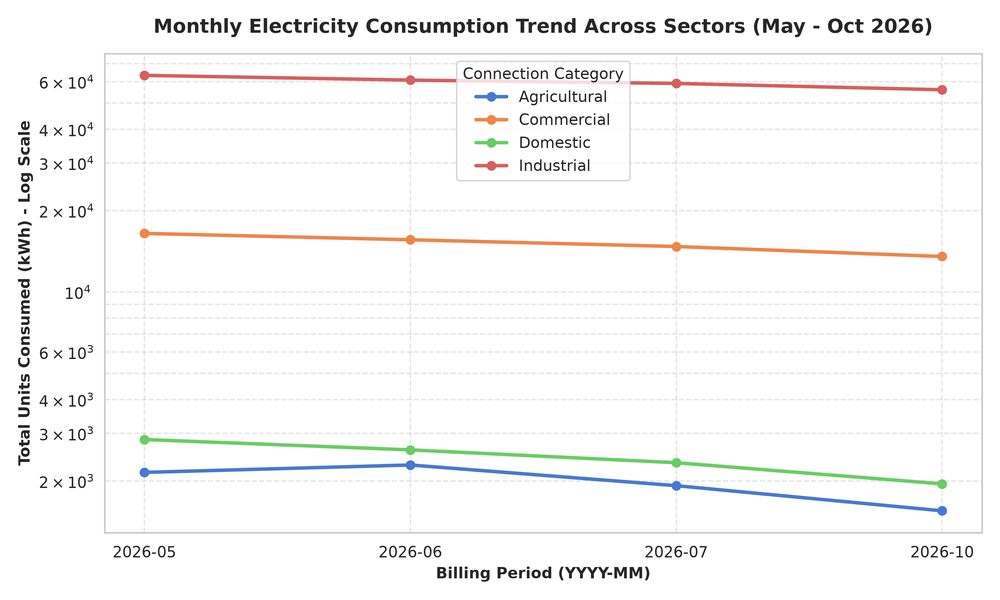
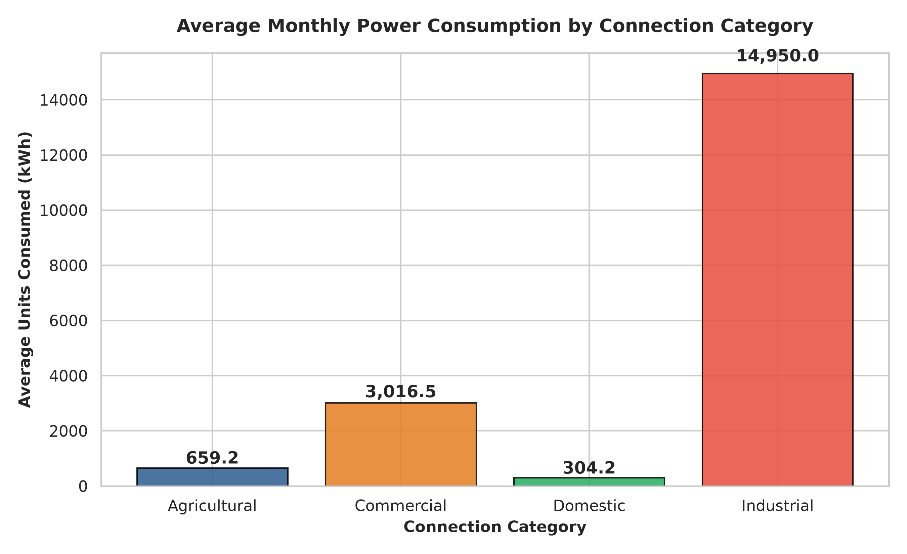
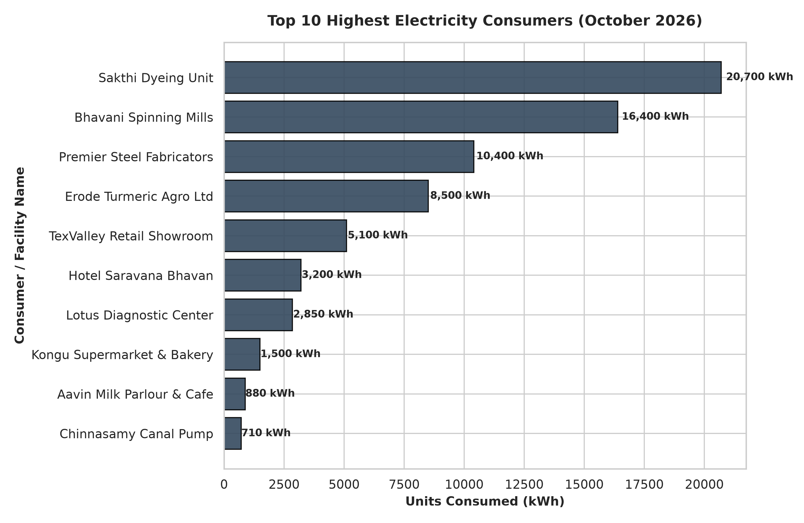
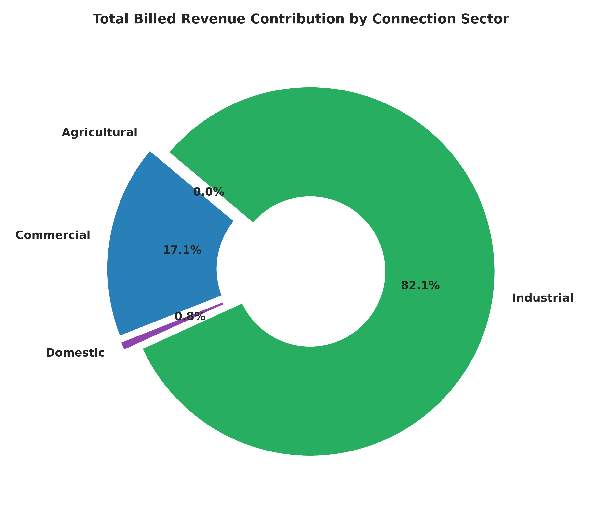
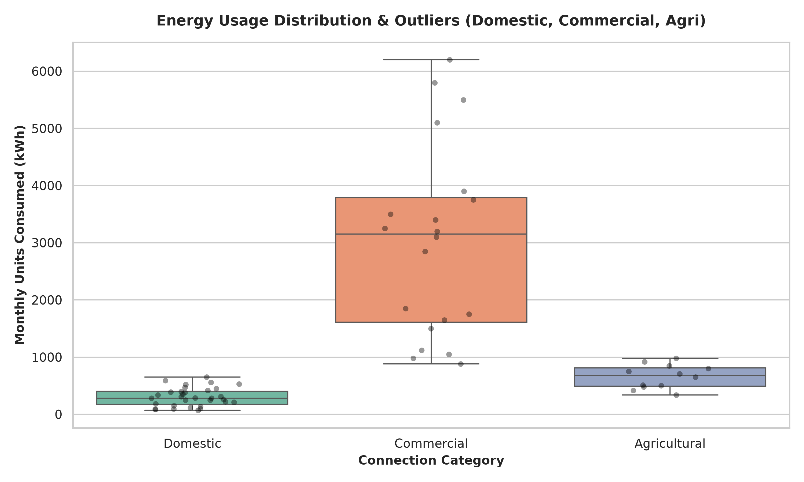
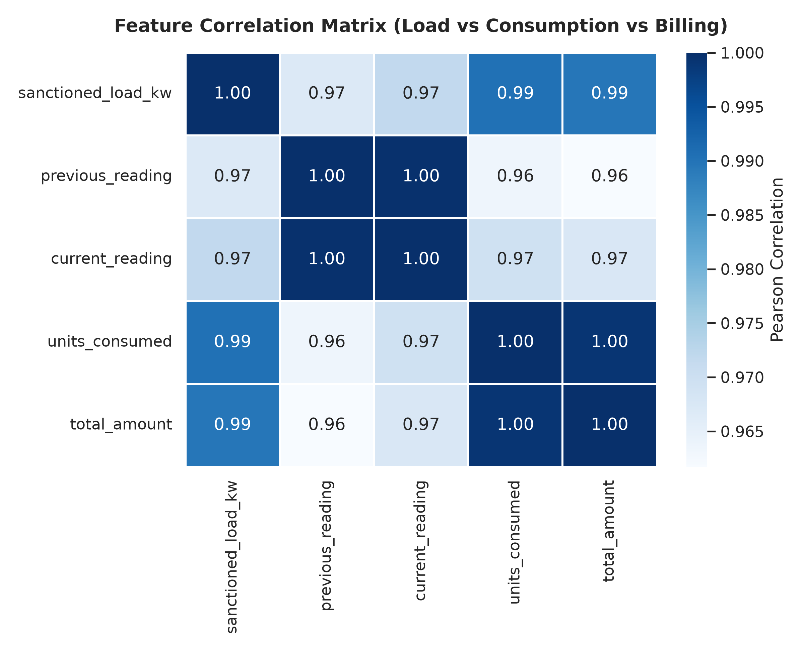

# Electricity Consumption Management and Energy Usage Analysis System
[](https://github.com/KANISHKA-0312/electricity-consumption-management/actions)
[](https://kanishka-0312.github.io/electricity-consumption-management/)
[](https://codespaces.new/KANISHKA-0312/electricity-consumption-management)

### Department of Information Technology — Velalar College of Engineering and Technology, Erode - 12
**Academic Year:** 2026-27 (ODD) | **Class:** 25IT3A&B  
**Activity:** Project-Based Assessment  
**Assigned Scenario:** **Scenario 14 (Register No.: 14, 44, 74, 104)**  
**Integrated Courses:**
- **25ITT31:** Database Management Systems
- **25ITT32:** Java Programming
- **25ITT33:** Software Engineering
- **25ITC31:** Foundations of Data Science

---

## 🌐 Live Interactive Web Dashboard
You can test and run this system live right in your browser via GitHub Pages:  
👉 **[https://kanishka-0312.github.io/electricity-consumption-management/](https://kanishka-0312.github.io/electricity-consumption-management/)**

* **Interactive Features:**
  - Real-time slab-based bill calculation with live preview
  - Searchable directory of 20 consumer accounts
  - High-consumption threshold profiler with instant filter slider
  - Interactive Chart.js graphs for seasonal usage and revenue share
  - Direct syllabus deliverables viewer

---

## 📌 Project Overview & Problem Statement
An electricity distribution circle office maintains consumer details, meter readings, monthly electricity consumption, and billing records across diverse consumer sectors (Domestic, Commercial, Industrial, and Agricultural). Managing these operations manually causes significant errors in slab-based bill calculations, creates delays in revenue auditing, and makes it challenging to detect abnormal high-consumption power loads and seasonal demand shifts over time.

This project delivers an end-to-end automated **Electricity Consumption Management and Energy Usage Analysis System** developed using **Java**, **DBMS (SQL)**, and **Python (Data Science & Visualizations)**.

---

## 🚀 Key Functional Capabilities

1. **Consumer Profile Management:** Register and maintain consumer records (Consumer ID, Name, Address, City, Phone, Email, Connection Category, Sanctioned Load in kW, Meter Serial Number, and Status).
2. **Meter Reading Administration:** Log previous and current readings with integrity constraints (`Current Reading >= Previous Reading`), computing net consumption (`Units Consumed = Current - Previous`).
3. **Statutory Tariff Calculation Engine:** Accurately calculates charges based on real-world multi-slab rates:
   - **Domestic (Telescopic Slabs):** 0–100 units Free (100% subsidy); 101–200 units @ ₹2.25/unit (Fixed ₹20); 201–400 units @ ₹4.50/unit (Fixed ₹30); 401–500 units @ ₹6.00/unit (Fixed ₹50); Above 500 units @ ₹8.00/unit (Fixed ₹80).
   - **Commercial:** 0–100 units @ ₹6.50/unit; Above 100 units @ ₹9.50/unit (Fixed ₹150).
   - **Industrial:** 0–500 units @ ₹8.00/unit; Above 500 units @ ₹11.50/unit (Fixed ₹500).
   - **Agricultural:** Flat nominal ₹0.50/unit with 100% government power subsidy (Net Payable = ₹0.00).
   - **Statutory Taxes:** 5% Electricity Duty on energy and fixed charges.
4. **Standardized Bill Invoicing:** Generates itemized billing statements displaying units consumed, breakdown charges, subsidy deductions, due dates, and payment settlement tracking.
5. **Circle Consumption & Revenue Reporting:** Produces aggregated monthly circle performance reports detailing consumer counts, total kWh demand, billed revenue, and collection efficiency per sector.
6. **High-Consumption Profiling:** Automatically identifies and ranks accounts exceeding power consumption thresholds (e.g., > 400 kWh) to flag potential domestic-to-commercial tariff violations and heavy loads.
7. **Python Data Science & Visualization Pipeline:** Ingests database history, cleans data, identifies outliers using the Interquartile Range (IQR) technique, and produces 6 publication-ready visualization charts.

---

## 📂 Repository File Structure

```
electricity-consumption-management/
│
├── .github/workflows/ci.yml           # Automated CI/CD build, test & artifact pipeline
├── .devcontainer/devcontainer.json    # 1-Click GitHub Codespaces cloud configuration
│
├── README.md                          # Master project documentation
│
├── docs/                              # Assessment Documentation & GitHub Pages Web App
│   ├── index.html                     # Live interactive web application dashboard
│   ├── SRS.md                         # Software Requirements Specification (IEEE 830)
│   ├── System_Design.md               # Use Case, Class, Architecture & Sequence Diagrams
│   ├── Database_Design.md             # ER Diagram, Relational Model & Normalization (1NF to BCNF)
│   └── Testing_Report.md              # Test Strategy, BVA, Equivalence Partitioning & Test Cases
│
├── database/                          # DBMS Deliverables (Course 25ITT31)
│   ├── schema.sql                     # Complete DDL: Tables, Constraints, Indexes, Views
│   ├── seed_data.sql                  # Comprehensive sample dataset (20 consumers, 6 billing cycles)
│   ├── queries.sql                    # Analytical & operational SQL queries (Top-N, joins, views)
│   └── electricity_consumption_dataset.csv  # Preprocessed dataset for immediate analysis
│
├── java-app/                          # Java Application Deliverables (Course 25ITT32)
│   ├── bin/                           # Compiled Java bytecode (.class files)
│   ├── sample_output.txt              # Complete terminal execution transcript with sample I/O
│   └── src/com/ecms/
│       ├── Main.java                  # Interactive menu-driven console application
│       ├── model/                     # POJO models (Consumer, MeterReading, Bill, ConnectionType)
│       ├── service/                   # TariffCalculator, ConsumerService, BillingService
│       └── dao/                       # DatabaseManager (in-memory + persistence)
│
└── python-analysis/                   # Data Science Deliverables (Course 25ITC31)
    ├── requirements.txt               # Dependencies (pandas, numpy, matplotlib, seaborn)
    ├── data_analysis.py               # Complete Python data processing & EDA script
    ├── analysis_notebook.ipynb        # Interactive Jupyter Notebook with analysis & plots
    └── visualizations/                # Generated publication-ready visualization charts (PNG)
        ├── 01_monthly_consumption_trend.png
        ├── 02_consumption_by_connection_type.png
        ├── 03_top_high_consumers.png
        ├── 04_revenue_distribution_by_type.png
        ├── 05_consumption_outlier_boxplot.png
        └── 06_correlation_heatmap.png
```

---

## 📊 Analytical Visualizations Gallery

The Python data analytics pipeline automatically generated these 6 visualization charts:

| Visual 1: Monthly Usage Trend | Visual 2: Category Mean Consumption |
|---|---|
|  |  |

| Visual 3: Top 10 High Energy Consumers | Visual 4: Revenue Share by Sector |
|---|---|
|  |  |

| Visual 5: Consumption Outliers (Box Plot) | Visual 6: Correlation Matrix |
|---|---|
|  |  |

---

## ⚙️ Execution and Setup Instructions

### 1. Online Execution via GitHub Codespaces
Click the badge below to start a full cloud development environment in seconds with all runtimes pre-configured:  
[](https://codespaces.new/KANISHKA-0312/electricity-consumption-management)

### 2. Local Java Application Execution
```bash
# Navigate to java-app directory
cd java-app

# Compile (if needed)
javac -d bin $(find src -name "*.java")

# Run the console application
java -cp bin com.ecms.Main
```

### 3. Database (SQL) Setup
```bash
# Using SQLite
sqlite3 electricity_billing.db < database/schema.sql
sqlite3 electricity_billing.db < database/seed_data.sql

# Test analytical query
sqlite3 electricity_billing.db < database/queries.sql
```

### 4. Python Data Science Analytics
```bash
cd python-analysis
pip install -r requirements.txt
python data_analysis.py
```

---

## 👥 Student Assessment Details
- **Institution:** Velalar College of Engineering and Technology (Autonomous), Thindal, Erode - 638012
- **Department:** Department of Information Technology
- **Academic Year:** 2026-27 (ODD Semester)
- **Class:** 25IT3A&B
- **Scenario Number:** Scenario 14
- **Student Register Numbers:** 14, 44, 74, 104
