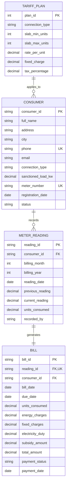

# Database Design and Normalization Document
## Electricity Consumption Management and Energy Usage Analysis System
**Institution:** Velalar College of Engineering and Technology, Erode - 638012  
**Department:** Information Technology  
**Course Code:** 25ITT31 - Database Management Systems | **Academic Year:** 2026-27 (ODD) | **Class:** 25IT3A  
**Student Name:** Kanishka | **Register No.:** 44  
**Assigned Project Scenario:** Scenario 14 (Register No.: 44)

---

## 1. Entity-Relationship (ER) Diagram

The ER model represents the entities, their structural attributes, primary keys, and cardinality constraints.



### Cardinality & Structural Constraints
1. **CONSUMER to METER_READING (1 : N):** A consumer can have multiple monthly meter readings recorded over time; each reading belongs to exactly one consumer.
2. **METER_READING to BILL (1 : 1):** Each periodic meter reading produces exactly one official bill invoice.
3. **TARIFF_PLAN to CONSUMER (1 : N):** Each connection category (Domestic, Commercial, Industrial, Agricultural) dictates the tariff slabs applicable to consumers belonging to that category.

---

## 2. Relational Model Schema

The relational schema translates the ER model into tabular relations with primary keys (**PK**), foreign keys (**FK**), and check constraints:

- **CONSUMERS** (<ins>consumer_id</ins>, full_name, address, city, phone, email, connection_type, sanctioned_load_kw, meter_number, registration_date, status)
- **TARIFF_PLANS** (<ins>plan_id</ins>, connection_type, slab_min_units, slab_max_units, rate_per_unit, fixed_charge, tax_percentage)
- **METER_READINGS** (<ins>reading_id</ins>, *consumer_id*, billing_month, billing_year, reading_date, previous_reading, current_reading, units_consumed, recorded_by)  
  *FK: consumer_id references CONSUMERS(consumer_id)*  
  *CHECK (current_reading >= previous_reading)*  
  *UNIQUE (consumer_id, billing_month, billing_year)*
- **BILLS** (<ins>bill_id</ins>, *reading_id*, *consumer_id*, bill_date, due_date, units_consumed, energy_charges, fixed_charges, electricity_duty, subsidy_amount, total_amount, payment_status, payment_date)  
  *FK: reading_id references METER_READINGS(reading_id)*  
  *FK: consumer_id references CONSUMERS(consumer_id)*

---

## 3. Data Dictionary

| Table Name | Column Name | Data Type | Constraints | Description |
|---|---|---|---|---|
| **consumers** | `consumer_id` | VARCHAR(20) | PRIMARY KEY | Unique alphanumeric consumer ID |
| | `full_name` | VARCHAR(100) | NOT NULL | Consumer account holder's name |
| | `address` | VARCHAR(255) | NOT NULL | Physical premises address |
| | `city` | VARCHAR(50) | DEFAULT 'Erode' | City/town name |
| | `phone` | VARCHAR(15) | NOT NULL, UNIQUE | 10-digit mobile contact number |
| | `email` | VARCHAR(100) | NULLABLE | Email for e-bills |
| | `connection_type` | VARCHAR(20) | NOT NULL, CHECK | Domestic, Commercial, Industrial, Agricultural |
| | `sanctioned_load_kw` | DECIMAL(6,2) | NOT NULL, CHECK (>0) | Approved power capacity in kW |
| | `meter_number` | VARCHAR(30) | NOT NULL, UNIQUE | Hardware energy meter serial ID |
| | `registration_date` | DATE | NOT NULL | Date connection energized |
| | `status` | VARCHAR(15) | CHECK | Active, Suspended, Disconnected |
| **meter_readings** | `reading_id` | VARCHAR(25) | PRIMARY KEY | Unique meter reading transaction ID |
| | `consumer_id` | VARCHAR(20) | NOT NULL, FK | Reference to `consumers` |
| | `billing_month` | INTEGER | CHECK (1-12) | Billing cycle calendar month |
| | `billing_year` | INTEGER | CHECK (>= 2020) | Billing cycle calendar year |
| | `reading_date` | DATE | NOT NULL | Date field measurement taken |
| | `previous_reading` | DECIMAL(10,2) | CHECK (>= 0) | Prior cycle meter cumulative units |
| | `current_reading` | DECIMAL(10,2) | CHECK (>= prev) | Current cycle meter cumulative units |
| | `units_consumed` | DECIMAL(10,2) | NOT NULL | Net kWh consumption |
| | `recorded_by` | VARCHAR(50) | DEFAULT 'Staff' | Staff name/ID recording meter |
| **bills** | `bill_id` | VARCHAR(25) | PRIMARY KEY | Unique invoice number |
| | `reading_id` | VARCHAR(25) | NOT NULL, FK, UNIQUE | Associated reading ID |
| | `consumer_id` | VARCHAR(20) | NOT NULL, FK | Billed consumer ID |
| | `bill_date` | DATE | NOT NULL | Invoice generation date |
| | `due_date` | DATE | NOT NULL, CHECK | Last date for payment without penalty |
| | `units_consumed` | DECIMAL(10,2) | NOT NULL | Billed energy units |
| | `energy_charges` | DECIMAL(10,2) | CHECK (>= 0) | Computed slab cost |
| | `fixed_charges` | DECIMAL(8,2) | NOT NULL | Category statutory fixed charge |
| | `electricity_duty` | DECIMAL(8,2) | NOT NULL | 5% electricity tax |
| | `subsidy_amount` | DECIMAL(8,2) | NOT NULL | Government subsidy deduction |
| | `total_amount` | DECIMAL(10,2) | CHECK (>= 0) | Final payable amount |
| | `payment_status` | VARCHAR(15) | CHECK | Paid, Unpaid, Overdue |
| | `payment_date` | DATE | NULLABLE | Date payment settled |

---

## 4. Normalization Documentation

To guarantee data integrity and eliminate insertion, update, and deletion anomalies, the database schema was designed using relational normalization principles:

### 4.1 Unnormalized Form (UNF)
In a non-relational manual spreadsheet or flat file, all attributes are stored in a single table:
```
UNF = {consumer_id, full_name, address, phone, connection_type, sanctioned_load, meter_number, billing_month, billing_year, previous_reading, current_reading, units_consumed, slab_rates, fixed_charge, energy_charges, duty, total_amount, payment_status, payment_date}
```
**Anomalies Present in UNF:**
- **Redundancy:** Consumer name and address repeated every month for each reading.
- **Update Anomaly:** Updating a phone number requires modifying every past reading record.
- **Insertion Anomaly:** Cannot register a new consumer before taking their first meter reading.
- **Deletion Anomaly:** Deleting a bill record deletes the historical record of the consumer.

### 4.2 First Normal Form (1NF)
**Condition:** A relation is in 1NF if all attribute values are atomic (indivisible) and there are no repeating groups.
- All composite and multivalued attributes (like reading history arrays) are flattened.
- Defined primary key for each tuple: `(consumer_id, billing_month, billing_year)`.

### 4.3 Second Normal Form (2NF)
**Condition:** A relation is in 2NF if it is in 1NF and every non-prime attribute is **fully functionally dependent** on the primary key (no partial dependencies).
- In the composite key `(consumer_id, billing_month, billing_year)`:
  - `consumer_id -> {full_name, address, phone, connection_type, sanctioned_load, meter_number}` is a **partial dependency** because consumer details depend only on `consumer_id`, not on `billing_month` or `billing_year`.
- **Decomposition for 2NF:**
  - Create relation `CONSUMERS` with primary key `consumer_id`.
  - Create relation `METER_READINGS` with primary key `reading_id` and foreign key `consumer_id`.

### 4.4 Third Normal Form (3NF)
**Condition:** A relation is in 3NF if it is in 2NF and no non-prime attribute is **transitively dependent** on the primary key (no $X \rightarrow Y$ and $Y \rightarrow Z$).
- In `METER_READINGS`, tariff parameters and bill amounts were calculated:
  - `reading_id -> connection_type -> {slab_rates, fixed_charge, duty}`
  - `reading_id -> units_consumed -> energy_charges -> total_amount`
  - These represent transitive dependencies.
- **Decomposition for 3NF:**
  - Separate `TARIFF_PLANS` table keyed by `plan_id` (dependent on `connection_type`).
  - Separate `BILLS` table keyed by `bill_id` (referencing `reading_id`).
  - `CONSUMERS`, `METER_READINGS`, `TARIFF_PLANS`, and `BILLS` are all in 3NF.

### 4.5 Boyce-Codd Normal Form (BCNF)
**Condition:** A relation is in BCNF if for every non-trivial functional dependency $X \rightarrow Y$, the determinant $X$ is a **superkey**.
- In `CONSUMERS`:
  - `consumer_id -> {all attributes}` ($X$ is PK, valid superkey)
  - `phone -> {consumer_id, full_name, ...}` ($X$ is unique candidate key)
  - `meter_number -> {consumer_id, ...}` ($X$ is unique candidate key)
- In `METER_READINGS`:
  - `reading_id -> {all attributes}` ($X$ is PK)
  - `(consumer_id, billing_month, billing_year) -> {all attributes}` (Candidate key)
- In `BILLS`:
  - `bill_id -> {all attributes}` ($X$ is PK)
  - `reading_id -> {all attributes}` (Candidate key)
- All determinants in all relations are superkeys. Hence, the relational schema achieves **BCNF** while preserving all functional dependencies and ensuring lossless joins.
