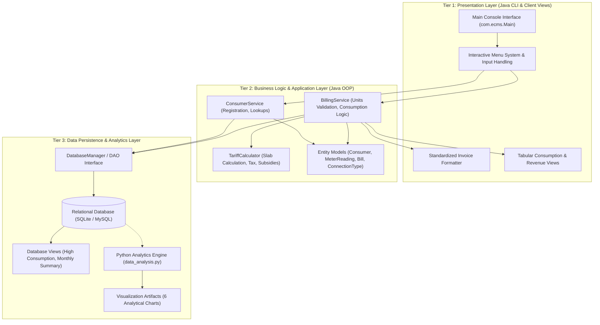
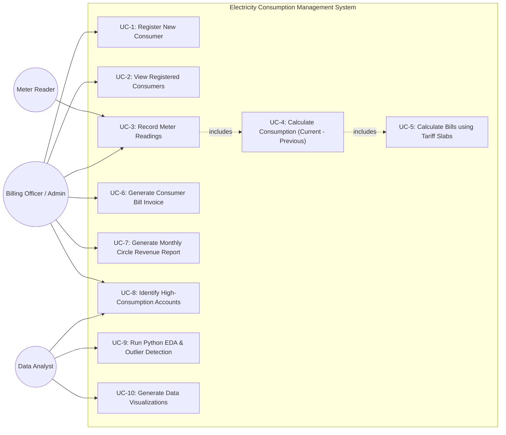
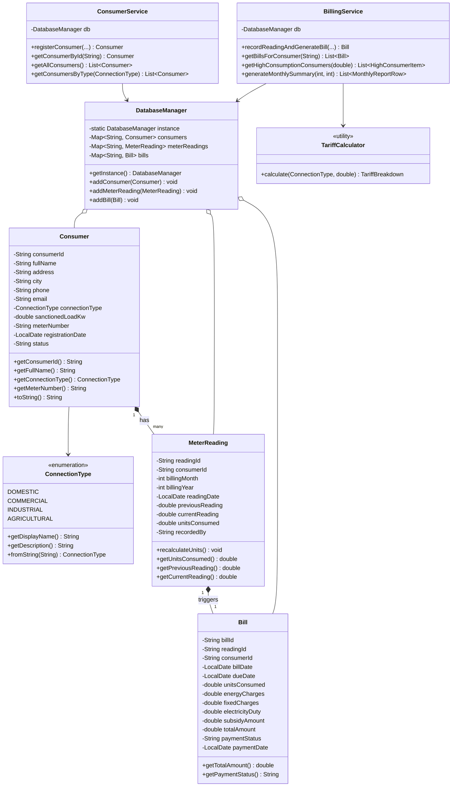
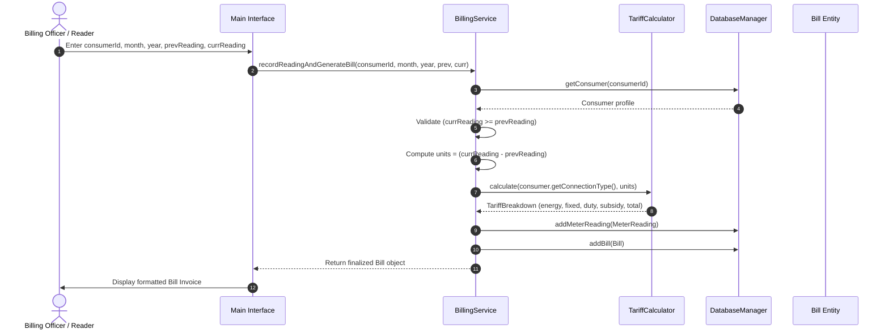

# System Design Document
## Electricity Consumption Management and Energy Usage Analysis System
**Institution:** Velalar College of Engineering and Technology, Erode - 638012  
**Department:** Information Technology  
**Course Code:** 25ITT33 - Software Engineering | **Academic Year:** 2026-27 (ODD) | **Class:** 25IT3A  
**Student Name:** Kanishka | **Register No.:** 44  
**Assigned Project Scenario:** Scenario 14 (Register No.: 44)

---

## 1. Overall System Architecture

The Electricity Consumption Management and Energy Usage Analysis System adopts a clean **Three-Tier Architecture**:
1. **Presentation / Interface Layer:** Console CLI providing interactive menus, structured prompts, formatted invoice presentation, and tabular reports.
2. **Business Logic & Service Layer:** Core Java domain services including `ConsumerService`, `BillingService`, and `TariffCalculator`.
3. **Data & Analytics Layer:** Relational DBMS (SQL Schema, Tables, Views, Indexes) and Python Data Science pipeline (`pandas`, `matplotlib`, `seaborn`).

---

## 2. Use Case Diagram

The system serves three primary actors: **Meter Reader Staff**, **Billing Officer / Admin**, and the **Data Analyst**.

---

## 3. Class Diagram (UML)

The class structure demonstrates object-oriented design principles: **Encapsulation**, **Inheritance**, **Polymorphism**, and **Modularity**.

---

## 4. Sequence Diagram: Meter Reading & Bill Invoicing Flow

